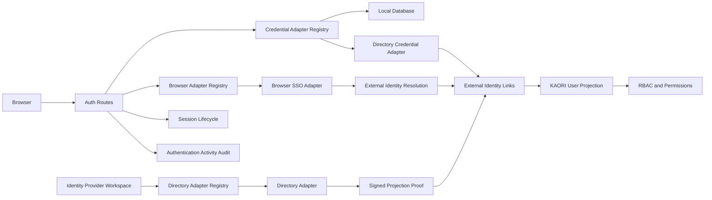

# Authentication Architecture

## Objective

KAORI uses a provider-neutral authentication architecture in the Access domain. Provider identity and technical protocol are intentionally separate so new identity products can reuse existing protocol adapters without refactoring User Management, RBAC, routes, or persistence.

The canonical hierarchy is:

```text
Access
→ Identity Provider
→ Provider
→ Adapter
→ Authentication / Directory Flow
→ External Identity Projection
→ KAORI User
→ RBAC
```

Identity Provider follows the same architectural principle as KAORI infrastructure Integrations, but it remains under the authentication boundary rather than `app/integrations/`.

## Context and Boundary



## Canonical Provider Vocabulary

`app/definitions/catalogs/access/authentication/identity_provider/providers.yaml` is the source-controlled provider catalog. `app/access/authentication/identity_provider/catalog.py` is its runtime vocabulary loader.

Every provider definition separates:

- `provider_key` — product/authority identity;
- `adapter_key` — technical implementation contract;
- `family` — `database`, `directory`, or `sso`;
- `flow` — `credentials` or `browser`;
- `configuration_profile` — configuration shape;
- `admission_policy` — projection/JIT admission contract.

Examples:

```text
provider_key=google          adapter_key=google_oidc
provider_key=github          adapter_key=github_oauth2
provider_key=ldap_directory  adapter_key=ldap
provider_key=database        adapter_key=local_database
```

Product identity must not be encoded in core form branches, route branches, or ORM columns.

## Code Ownership

### Authentication Kernel

`app/access/authentication/identity_provider/` owns provider vocabulary, adapter protocols, adapter registries, provider-specific protocol implementations, and normalized authentication/directory outcomes.

Reusable protocols live under:

```text
app/access/authentication/identity_provider/adapters/
├── ldap/
├── oidc/
└── oauth2/
```

Provider-specific behavior lives under:

```text
app/access/authentication/identity_provider/providers/<provider>/
```

For browser SSO, source-controlled provider definitions also own a `browser_profile` that separates protocol identity from provider identity. A browser profile declares protocol, scopes, trusted discovery/endpoints, identity resolver, PKCE policy, and bounded authorization parameters. Runtime provider instances do not become the authority for protocol endpoints or provider identity semantics.

### Identity Provider Workspace

`app/access/identity_providers/` owns provider administration, validation, directory search, signed administrative identity projection, and workspace presentation.

Its canonical UI is `/access/identity-providers` with:

```text
Overview · Providers · Directory Provisioning
```

### User Management

`app/access/users/` owns KAORI user lifecycle, effective access presentation, and role assignment. It does not own provider configuration.

### RBAC

RBAC owns roles, permissions, route guards, menu visibility, and operational authorization. Provider adapters must not assign hidden permissions. `is_super_admin` is reserved for Local Database break-glass identities.

## Browser Protocol / Provider Separation

The browser extension model is:

```text
Provider Definition
→ Browser Provider Profile
→ Reusable Protocol Adapter
→ Provider-specific Identity Resolver when required
→ SsoIdentity
→ External Identity Projection
```

OIDC is a reusable authentication protocol. Its adapter owns discovery, issuer/JWKS validation, Authorization Code flow, ID-token validation, nonce, audience/time validation, PKCE policy, and normalized claims.

OAuth2 is not treated as a universal identity protocol. Its reusable layer owns Authorization Code transport/security only. Provider-specific resolvers own identity APIs and immutable subject extraction. GitHub is the reference OAuth2 shape.

Normal provider onboarding must not require core route, session, User Management, RBAC, or schema changes when an admitted adapter/profile can express the provider.

## Adapter Registries

KAORI maintains separate registries because the protocol contracts are different:

- credential adapter registry;
- browser SSO adapter registry;
- directory adapter registry.

Application routes dispatch using `adapter_key`; they do not instantiate LDAP, Google, GitHub, or future products directly.

## Provider Lifecycle

1. **Registered** — provider identity and adapter contract exist.
2. **Configured** — required non-secret configuration and secret references exist.
3. **Validated** — adapter-level connectivity/protocol and admission-policy checks pass.
4. **Enabled** — new authentication/provisioning attempts may use the provider.
5. **Review Required** — enabled configuration, JIT/admission, or projection posture is incomplete.
6. **Disabled** — new attempts are rejected while identity links and audit evidence remain.

## Error Normalization

Protocol exceptions never cross the HTTP boundary directly.

Examples include:

- invalid password → `invalid_credentials`;
- inactive linked user → `user_inactive`;
- database failure → `database_unavailable`;
- external protocol outage → `provider_unavailable`;
- missing projection/admission failure → `identity_not_provisioned`;
- browser callback failures → explicit normalized SSO reason codes.

## Redirect Contract

Successful authentication routes to `welcome.index`. Authentication does not encode role-specific destination logic. Every destination independently applies server-side permission checks.

## Extension Contract

Adding a new identity product must follow this order:

1. determine whether an admitted reusable adapter fits;
2. add the provider definition and browser/directory profile to the source-controlled catalog;
3. reuse the existing configuration profile when it can express the provider;
4. add provider-specific identity resolution only when protocol-neutral normalization cannot supply it;
5. add provider-specific admission policy/guidance only where semantics genuinely differ;
6. validate catalog/registry/contracts and real-provider behavior.

For browser providers:

```text
Conforming OIDC provider
→ provider definition/profile
→ reusable oidc adapter
→ optional bounded claim/profile delta

OAuth2 identity provider
→ provider definition/profile
→ reusable oauth2 transport
→ provider-specific identity resolver
```

A genuinely new protocol receives its own bounded adapter workstream before provider onboarding.

Core routes, session lifecycle, User Management, RBAC, and database schema must remain unchanged when an existing adapter/profile can serve the provider.
