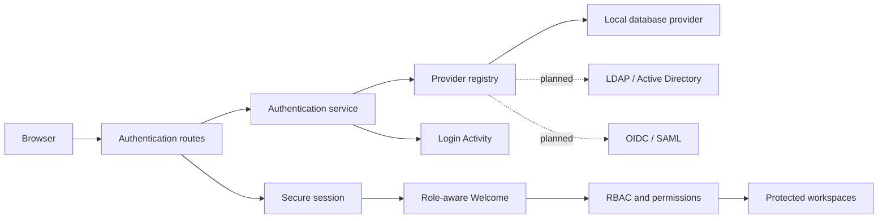

# Authentication architecture

## Objective

KAORI uses a provider-neutral authentication layer. The application owns session establishment, local user projection, Login Activity, account-state enforcement, and the handoff to RBAC. External systems remain authoritative for external credentials when LDAP or SSO is enabled.

## Context and boundary

## Responsibilities

Authentication owns identity verification, normalized provider results, session lifecycle, login metadata, and Login Activity. RBAC owns authorization, permission checks, role assignment, menu filtering, and action enforcement. User Management owns account lifecycle. Provider configuration will belong to Integrations or a dedicated Identity configuration workspace.

## Provider lifecycle

A provider progresses through these states:

1. **Declared** — code boundary and documentation exist.
2. **Configured** — deployment has connection/client settings.
3. **Validated** — connectivity, TLS, metadata, and required claims/attributes pass validation.
4. **Enabled** — users may choose or be routed to it.
5. **Degraded** — temporarily unavailable; local recovery remains accessible.
6. **Disabled** — no new authentication attempts are routed to it.

LDAP and SSO are currently declared only. Configuration names do not make them actionable.

## Redirect contract

Successful authentication always routes to the role-aware Welcome workspace. Authentication must not encode role-specific destination tables. Welcome and RBAC determine visible workspaces, while every destination independently enforces permission decorators.

## Extension points

- Provider adapters implement `AuthProvider` or a later flow-specific protocol.
- Browser-redirect SSO will require initiation and callback contracts separate from password-based `authenticate()`.
- External identity projection will map provider subject/DN to one local user.
- Role mapping will consume normalized groups/claims after authentication; it must not be hidden inside provider-specific routes.
