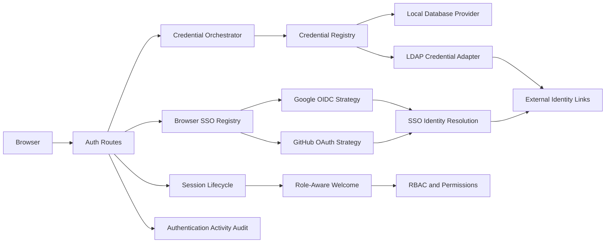

# Authentication Architecture

## Objective

KAORI uses a provider-neutral authentication core with two explicit protocol flows:

- **credential flow** for Local Database and LDAP;
- **browser SSO flow** for Google OpenID Connect and GitHub OAuth.

The application owns local user projection, account-state enforcement, session lifecycle, login metadata, and authentication Activity Audit records. External systems remain authoritative for external credentials and identities.

## Context and Boundary

## Canonical Provider Vocabulary

`app/auth/providers/catalog.py` is the authority for provider vocabulary.

- Family: `database`, `ldap`, `sso`.
- Concrete type: `database`, `ldap`, `google_oidc`, `github_oauth`.
- Flow: `credentials` or `browser`.

Family-level behavior includes user filtering and password ownership. Concrete types select protocol implementations and identity-provider configuration.

## Responsibility Boundaries

### Authentication

Owns credential verification, browser callback validation, normalized results, provider lookup, identity resolution, JIT admission, login metadata, session lifecycle, and authentication Activity Audit records.

### User Management

Owns provider administration UI, account lifecycle, role assignment, LDAP directory search initiation, and administrative external-identity projection. It calls Authentication-owned provider configuration and LDAP client boundaries.

### RBAC

Owns roles, permissions, route guards, menu visibility, and operational authorization. Provider adapters must not assign hidden permissions.

### Models

`app/models/identity.py` and `app/models/user.py` remain the persistence authority. Protocol modules do not define ORM models.

## Provider Registries

### Credential Registry

`CredentialProviderRegistry` always contains the Local Database provider and currently contains the LDAP adapter as its external credential provider. Local identity presence is authoritative: a wrong password for an existing Local Database user does not fall through to LDAP.

### Browser SSO Registry

Browser SSO is selected through `get_browser_sso_provider(provider_type)`. Routes do not contain Google/GitHub protocol branches. Unsupported provider types fail closed.

## Provider Lifecycle

1. **Configured** — provider record and secret references exist.
2. **Validated** — connection/discovery, TLS, secret reference, and JIT policy pass validation.
3. **Enabled** — new authentication attempts may use the provider.
4. **Degraded** — the provider is temporarily unavailable; Local Database recovery remains available.
5. **Disabled** — new attempts are rejected while existing audit history and identity links remain.

## Error Normalization

Provider exceptions never cross the HTTP boundary directly.

- invalid password → `invalid_credentials`;
- inactive linked user → `user_inactive`;
- database failure → `database_unavailable`;
- external protocol outage → `provider_unavailable`;
- missing SSO projection/admission failure → `identity_not_provisioned`;
- callback state/code failures → explicit SSO reason codes.

LDAP user-bind rejection and operational provider failure are distinguished internally so an outage is not silently reported as a bad password.

## Redirect Contract

Successful authentication routes to `welcome.index`. Authentication does not encode role-specific destination logic. Every destination independently applies server-side permission checks.

## Extension Contract

A new browser provider implements `BrowserSsoProvider` in a dedicated module and is registered once. A new credential provider implements `CredentialAuthProvider` and declares an explicit identity-collision policy. Provider-specific branches are prohibited in `app/auth/routes.py` and `app/users/routes.py`.
