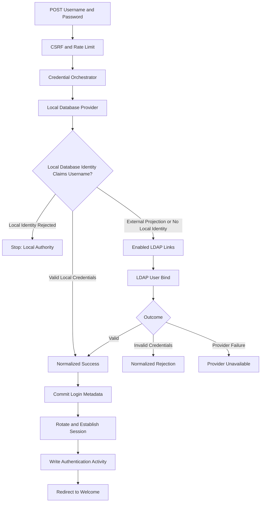
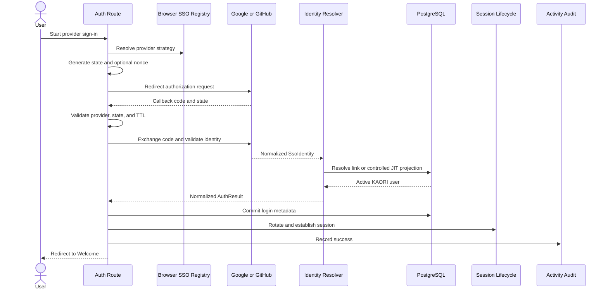

# Authentication Flows

## Credential Flow: Local Database and LDAP

The Local Database provider is evaluated first. A failed Local Database login stops credential dispatch when the account belongs to the Local Database; a provisioned external identity may continue to its enabled LDAP link even though its KAORI user row exists. LDAP never replaces Local Database password authority, and database outages fail closed.

LDAP authentication is link-based. KAORI loads enabled LDAP identity links case-insensitively and attempts them deterministically. `invalidCredentials` remains a credential rejection; connection, TLS, and operational bind failures become `provider_unavailable`.

## Browser SSO Flow: Google and GitHub

Google requires nonce validation. Both browser providers use a hashed state value stored in the signed session and a bounded flow lifetime. A malformed, mismatched, future-dated, or expired flow fails closed before code exchange.

## Failure Ordering

A successful authentication event is recorded only after login metadata commits and the authenticated session is established. A metadata commit failure is normalized to `database_unavailable`; KAORI does not record a false successful login.

Authentication Activity write failure is non-blocking after the security-critical login transaction has completed, but it is logged as an operational warning.

## Logout

Logout is POST-only and CSRF-protected. KAORI records the user-initiated logout, invokes Flask-Login logout, clears the complete authenticated session including step-up state and pending SSO flow state, then redirects to the login page.
