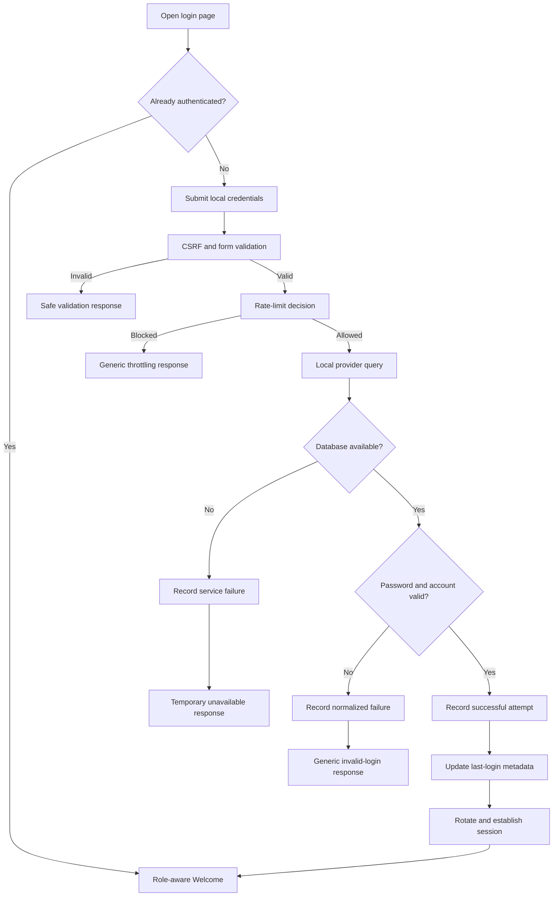
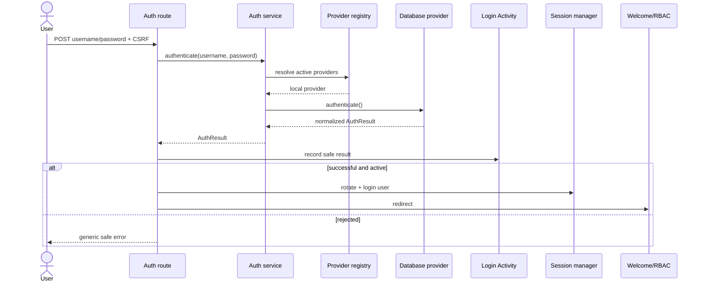

# Authentication flows

## Local database login activity

## Local login sequence

## Planned external login

SSO browser redirects and LDAP password authentication have different transport flows but must converge on one normalized identity result. After verification, KAORI resolves or provisions the local user projection, applies explicit role mapping, checks local account state, records Login Activity, and establishes the KAORI session. Failure of an external provider must retain access to the separately controlled local login path.

## Logout

Logout requires POST plus CSRF, invokes Flask-Login logout, removes auth-source and step-up session state, and redirects to login. It must not be implemented as an idempotent GET link because cross-site navigation could otherwise terminate sessions.
