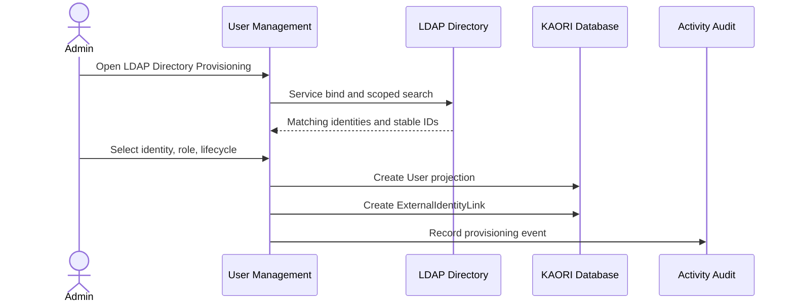
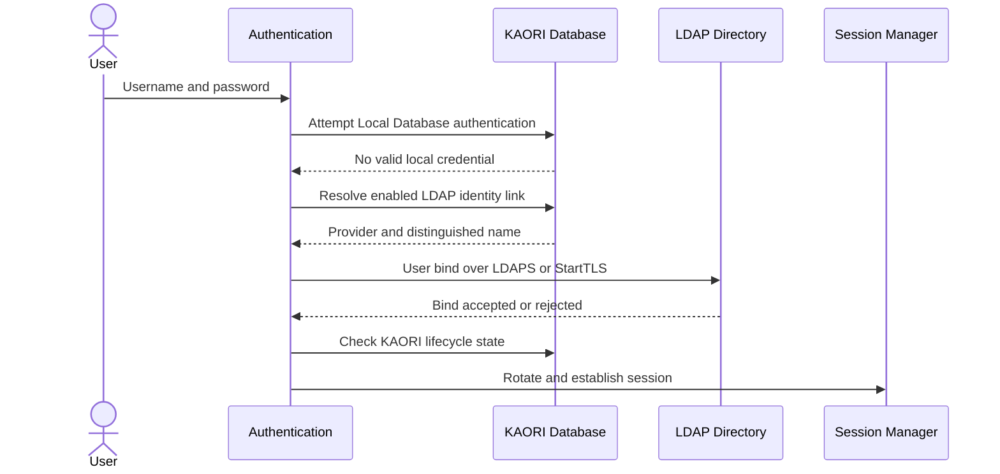

# External Identity Authentication Flow

## Scope

This phase activates LDAP authentication and prepares the shared provider boundary for OIDC SSO. Local Database authentication remains permanently available for break-glass recovery.

## LDAP administrative provisioning

KAORI never requests or stores the user's LDAP password during provisioning.

## LDAP login

The external provider verifies identity. KAORI remains authoritative for local lifecycle state and later RBAC evaluation.

## OIDC readiness

The provider schema reserves issuer, client ID, and client-secret environment references. OIDC cannot be enabled in this phase. The next phase adds redirect, callback, discovery, JWKS validation, state, nonce, issuer/audience verification, and `issuer + sub` identity linking.

## JIT policy

JIT provisioning is deliberately blocked until RBAC role mapping exists. Current LDAP onboarding is administrative provisioning only.
