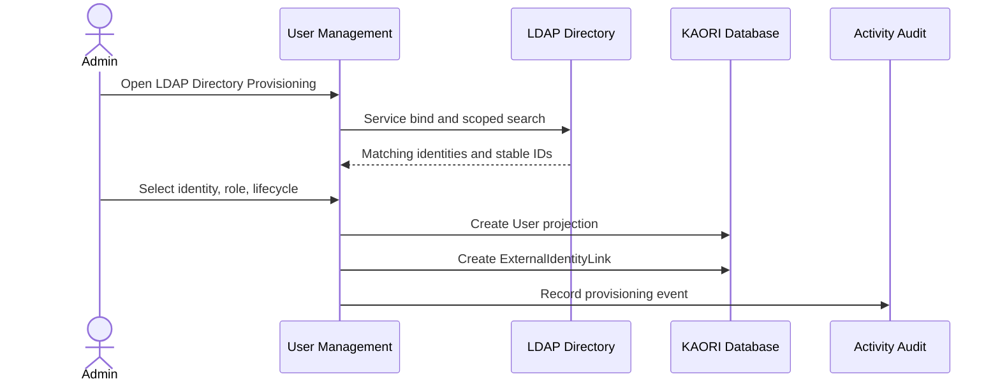
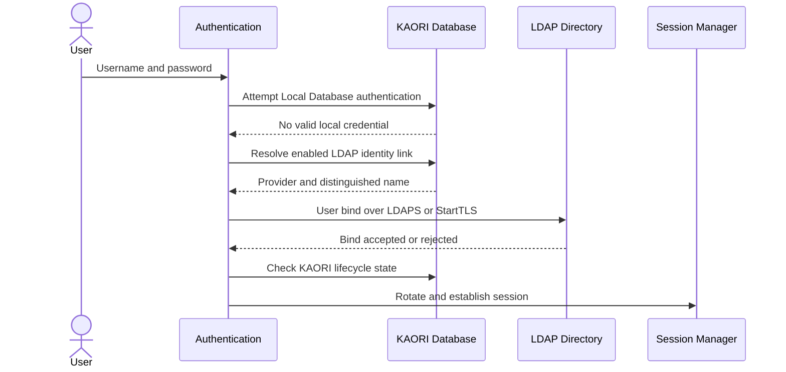
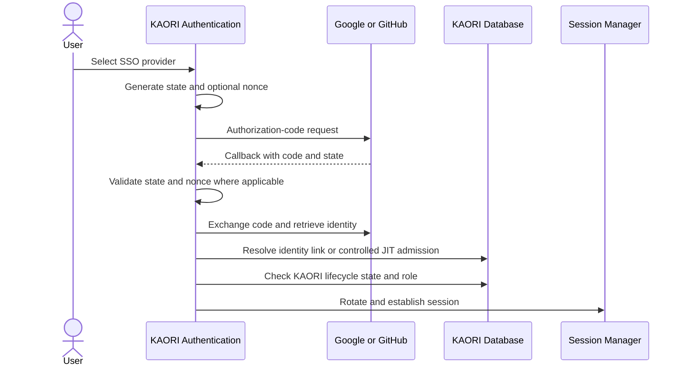

# External Identity Authentication Flow

## Scope

KAORI supports Local Database, LDAP / Active Directory, Google OpenID Connect, and GitHub OAuth authentication. Local Database remains permanently available for break-glass recovery. External providers verify identity; KAORI remains authoritative for account lifecycle and RBAC authorization.

Detailed provider configuration is documented in:

```text
docs/authentication/IDENTITY_PROVIDER_CONFIGURATION.md
```

## LDAP administrative provisioning



KAORI never requests or stores the user's LDAP password during provisioning.

## LDAP login



## Google and GitHub SSO login



## Projection and admission policy

- LDAP onboarding is administrative provisioning only.
- Google and GitHub can use pre-provisioned identity links.
- Controlled SSO JIT is optional and requires an active non-admin default role plus a provider-specific allow-list.
- Google JIT requires a verified email in an allowed domain.
- GitHub JIT requires the immutable numeric user ID or current login in the allow-list.
