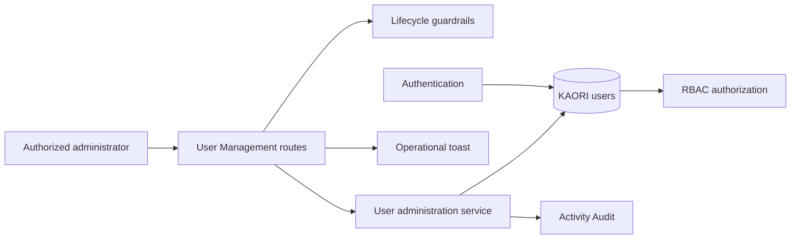

# User Management Architecture

## Boundary

User Management owns administrative records. Authentication verifies identity. RBAC decides what an authenticated user may do.

## Identity administration model

Local users are native identities. LDAP and SSO users are external identity projections. KAORI stores only the local projection, lifecycle override, assigned role, and provider linkage needed for authorization and audit.
