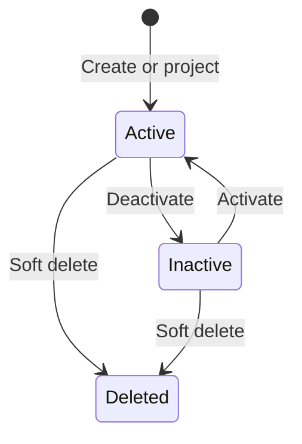

# User Lifecycle

Deleted users remain available for audit and controlled restore design. External-provider disablement and KAORI local deactivation are separate signals. A provider may authenticate an identity while KAORI still blocks access because the local projection is inactive.

Super-admin controls are orthogonal to lifecycle. The last active Local Database super admin is protected from deactivation, demotion, and deletion so KAORI always retains a database-backed break-glass path.
